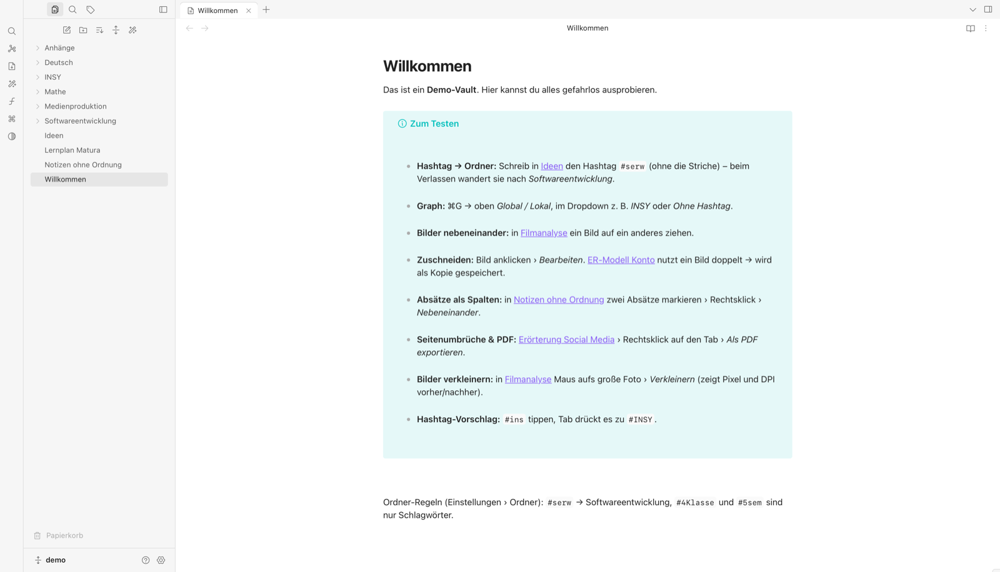
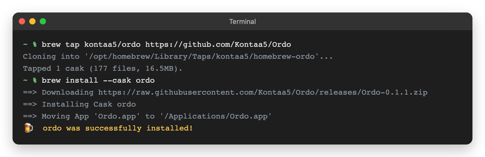
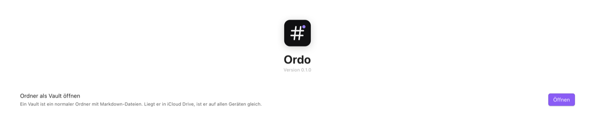
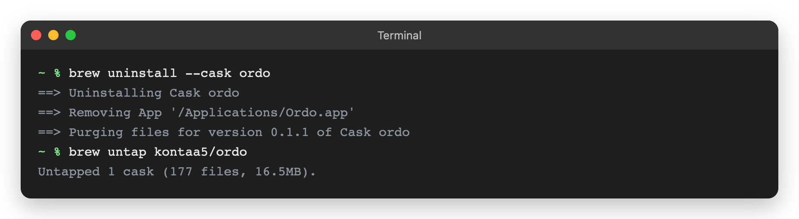

# Ordo

Markdown-Notizen wie in Obsidian: Hashtags sortieren Notizen in Ordner, PDF-Export nach Hashtag, Graph, Bilder, iCloud.



## Installieren

Voraussetzung: macOS 14 (Sonoma) oder neuer.

**1. Homebrew** – nur falls noch nicht installiert ([brew.sh](https://brew.sh)), im Terminal:

```bash
/bin/bash -c "$(curl -fsSL https://raw.githubusercontent.com/Homebrew/install/HEAD/install.sh)"
```

**2. Ordo installieren:**

```bash
brew tap kontaa5/ordo https://github.com/Kontaa5/Ordo
brew install --cask ordo
```



**3. Starten:** Ordo über Launchpad oder Spotlight öffnen, auf **Öffnen** klicken und einen Ordner wählen – ein bestehender Obsidian-Vault geht auch.



## Aktualisieren

```bash
brew upgrade --cask ordo
```

## Deinstallieren

```bash
brew uninstall --cask ordo
brew untap kontaa5/ordo
```



Deine Notizen bleiben erhalten – sie liegen in deinem Ordner, nicht in der App.
Auch die Einstellungen löschen: `brew uninstall --zap --cask ordo`.

## Funktionen

- 1. Hashtag = Ordner, 2. Hashtag = Unterordner (`#4klasse #medt` → `4klasse/medt/`)
- PDF-Export aller Notizen mit bestimmten Hashtags, Seitenumbrüche im Editor sichtbar
- Bilder zuschneiden, nebeneinander anordnen, ohne Qualitätsverlust verkleinern
- Graph nach Hashtags, Spalten, Obsidian-Themes, Hell/Dunkel, Deutsch/Englisch
- iCloud für Mac und iPhone, optional Git-Backup

iPhone: [docs/iPhone-Installation.md](docs/iPhone-Installation.md) · Entwicklung: [docs/Entwicklung.md](docs/Entwicklung.md)

## Lizenz

MIT – siehe [LICENSE](LICENSE).
